## Modèle Relationnel

{ .invert }

Concernant les **clés étrangères** : 

* Les clés étrangères permettent de relier des tables, et ainsi, d'éviter les **redondances** et faciliter les modifications.

* Une clé étrangère doit toujours être une référence **valide** (*contrainte d'intégrité référentielle*). Ainsi, pour supprimer un auteur, il faut d'abord supprimer tous les livres qui lui sont associés.

Le **schéma relationnel** s'écrit comme :

* <tt style="font-size: .9em">Livres(<u>isbn</u>: TEXT, titre: TEXT, annee: INT, #id_auteur)</tt>
* <tt style="font-size: .9em">Auteurs(<u>id</u>: INT, nom_complet: TEXT, annee_naissance: INT, pays: TEXT)</tt>

Les clés primaires sont <u>soulignés</u> et les clés étrangères sont précédées d'un <tt>#</tt>. 

## Requêtes SQL

Les exemples utilisent les tables `Livres` et `Auteurs` du schéma relationnel ci-dessus.

=== "Récupérer des données d'une table"

    ```{.sql .no-copy}
    SELECT colonne, autre_colonne, ...
    FROM nom_table
    WHERE condition [AND/OR] autre_condition [AND/OR] ...
    ORDER BY colonne [ASC/DESC];
    ```

=== "Exemple"

    ```sql
    -- titres et années des livres parus après 2000, du plus récent au plus ancien
    SELECT titre, annee
    FROM Livres
    WHERE annee > 2000
    ORDER BY annee DESC;
    ```

=== "Autre exemple"

    ```sql
    -- noms des auteurs français nés avant 1900
    SELECT nom_complet
    FROM Auteurs
    WHERE pays = 'France' AND annee_naissance < 1900;
    ```

<span></span>

=== "Récupérer des données de plusieurs tables (jointure)"

    ```{.sql .no-copy}
    SELECT table1.colonne, table2.colonne, ...

    FROM table1
    JOIN table2 ON table1.id = table2.id
    JOIN table3 ON table2.id = table3.id
    ...

    WHERE condition(s)
    ORDER BY colonne [ASC/DESC];
    ```

=== "Exemple"

    ```sql
    -- titre de chaque livre britannique avec le nom de son auteur
    SELECT Livres.titre, Auteurs.nom_complet
    FROM Livres
    JOIN Auteurs ON Livres.id_auteur = Auteurs.id
    WHERE Auteurs.pays = 'Royaume-Uni'
    ORDER BY Livres.titre ASC;
    ```

<span></span>

=== "Ajouter une ligne"

    ```{.sql .no-copy}
    INSERT INTO nom_table
    VALUES (valeur1, valeur2, ...);
    ```

=== "Exemple"

    ```sql
    -- l'auteur doit exister AVANT d'ajouter son livre
    INSERT INTO Auteurs
    VALUES (12, 'Ursula K. Le Guin', 1929, 'États-Unis');

    INSERT INTO Livres
    VALUES ('978-2253072980', 'Les Dépossédés', 1947, 12);
    ```

<span></span>

=== "Mettre à jour une ou des lignes"

    ```{.sql .no-copy}
    UPDATE nom_table
    SET colonne = valeur_ou_expression, 
        autre_colonne = valeur_ou_expression, 
        ...
    WHERE condition(s);
    ```

=== "Exemple"

    ```sql
    -- corriger l'année mal saisie (1947 au lieu de 1974)
    UPDATE Livres
    SET annee = 1974
    WHERE isbn = '978-2253072980';
    ```

<span></span>

=== "Supprimer une ou des lignes"

    ```{.sql .no-copy}
    DELETE FROM nom_table
    WHERE condition(s);
    ```

=== "Exemple"

    ```sql
    -- les livres de l'auteur doivent être supprimés AVANT l'auteur
    DELETE FROM Livres
    WHERE id_auteur = 12;

    DELETE FROM Auteurs
    WHERE id = 12;
    ```
