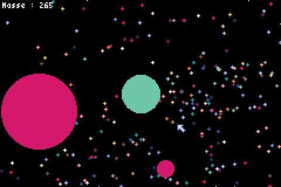
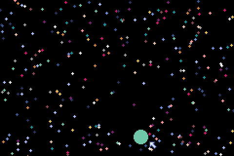
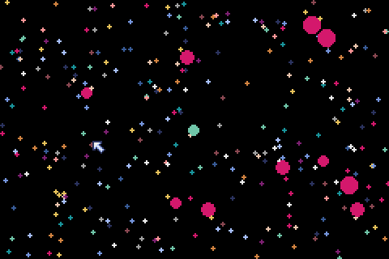
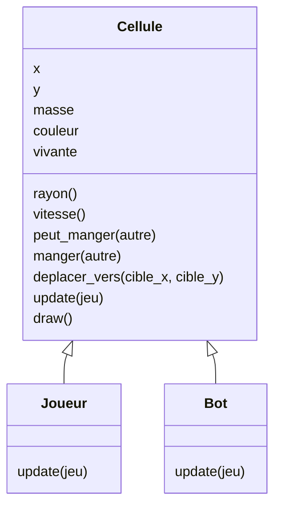
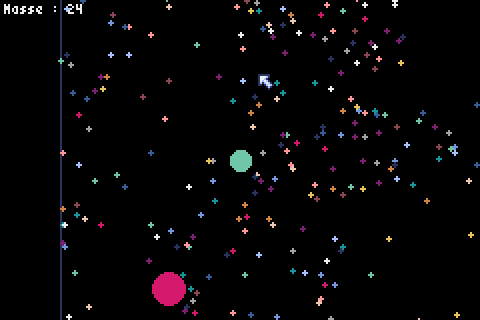

# Cellules, un Agar.io simplifié

## Description

Dans le jeu [Agar.io](https://fr.wikipedia.org/wiki/Agar.io), chaque joueur dirige une cellule dans une boîte de Petri. Le principe du jeu est simple&nbsp;: **on mange ce qui est plus petit que soi, on se fait manger par ce qui est plus gros.** Chaque repas fait grossir, mais plus on est gros, plus on est lent.

{ .rounded-img .pixel-img .center-img }

Le but de ce mini-projet est d'en programmer une version simplifiée avec le module **Pyxel** en **programmation orientée objet**.

Grains, joueur et bots sont **tous des cellules**&nbsp;: une seule classe `#!py Cellule` suffit pour créer des centaines d'objets. Le joueur et les bots ne diffèrent que par leur déplacement&nbsp;: on utilisera l'**héritage** (hors-programme).


## Rendu attendu

* Un **fichier `.py`** contenant la version la plus avancée de votre jeu. Il doit s'exécuter sans erreur, et chaque méthode doit être commentée.

* Un **compte rendu** qui répond aux questions numérotées et décrit les améliorations ajoutées dans la section « *À votre sauce* ».

!!! info "Documentation Pyxel"
    Toutes les fonctions de Pyxel utilisées dans ce projet (`#!py pyxel.circ`, `#!py pyxel.rndf`, `#!py pyxel.mouse_x`, `#!py pyxel.camera`…) sont décrites dans la [documentation de Pyxel](https://kitao.dev/pyxel/api-reference/).


## Le programme minimal

Pyxel fonctionne avec une **boucle de jeu**&nbsp;: tant que la fenêtre est ouverte, Pyxel appelle la méthode `#!py update` (mettre à jour les données du jeu), puis la méthode `#!py draw` (dessiner l'image), et recommence.

{ .center-img }

On regroupe tout le jeu dans une classe `#!py Jeu`. Les entités du jeu (grains, joueur, adversaires…) seront des **attributs** de cette classe.

=== "Code"
    ```python
    import pyxel

    LARGEUR_ECRAN = 240  # (1)!
    HAUTEUR_ECRAN = 160


    class Jeu:
        def __init__(self):
            pyxel.init(LARGEUR_ECRAN, HAUTEUR_ECRAN, title="Cellules", fps=60)  # (2)!
            pyxel.run(self.update, self.draw)  # (3)!

        def update(self):
            pass  # (4)!

        def draw(self):
            pyxel.cls(0)  # (5)!


    Jeu()  # (6)!
    ```

    1. Les dimensions de l'écran sont des **constantes**, écrites en majuscules. Elles resserviront pour placer les objets dans la fenêtre.

    2. On crée une **fenêtre** de 240 × 160 pixels, intitulée « Cellules », qui s'actualise **60 fois par seconde**.

    3. On démarre la boucle de jeu. Les méthodes `#!py self.update` et `#!py self.draw` sont écrites **sans parenthèses**&nbsp;: on ne les appelle pas, on les **donne** à Pyxel, qui les appellera à chaque image.

    4. Pour l'instant, il n'y a rien à mettre à jour.

    5. On efface l'écran en le remplissant avec la couleur 0 (noir).

    6. On crée **un seul** objet `#!py Jeu`&nbsp;: cela exécute `#!py __init__`, donc ouvre la fenêtre et lance la boucle de jeu.

=== "Rendu"
    { .center-img .pixel-img }

Ce code constitue **le point de départ** de n'importe quel jeu Pyxel&nbsp;.

<div class="sl-steps" start="1" markdown>

1. Ajouter `#!py print("bonjour")` juste après `#!py pyxel.run(...)`. Que se passe-t-il&nbsp;? Où faut-il donc créer les attributs de `#!py Jeu`&nbsp;?
</div>

## Une classe, des centaines d'objets

On écrit maintenant la classe `#!py Cellule`, puis on modifie `#!py Jeu` pour créer et afficher une cellule. Les lignes ajoutées par rapport au programme minimal sont surlignées&nbsp;:

=== "Code"

    ```python hl_lines="1 8-18 24 32"
    import math  # (1)!
    import pyxel

    LARGEUR_ECRAN = 240
    HAUTEUR_ECRAN = 160


    class Cellule:  # (2)!
        def __init__(self, x, y, masse):
            self.x = x  # (3)!
            self.y = y
            self.masse = masse

        def rayon(self):
            return math.sqrt(self.masse)  # (4)!

        def draw(self):
            pyxel.circ(self.x, self.y, self.rayon(), 7)  # (5)!


    class Jeu:
        def __init__(self):
            pyxel.init(LARGEUR_ECRAN, HAUTEUR_ECRAN, title="Cellules", fps=60)
            self.cellule = Cellule(120, 80, 100)  # (6)!
            pyxel.run(self.update, self.draw)

        def update(self):
            pass

        def draw(self):
            pyxel.cls(0)
            self.cellule.draw()  # (7)!


    Jeu()
    ```

    1. Le module `#!py math` fournit la racine carrée `#!py math.sqrt`.

    2. La classe est un **moule**&nbsp;: elle décrit ce qu'est une cellule, mais n'en crée aucune.

    3. Chaque objet `#!py Cellule` aura **ses propres** attributs `#!py x`, `#!py y` et `#!py masse`.

    4. Le rayon se calcule à partir de la masse (voir l'encadré ci-dessous).

    5. Un disque de centre `(x, y)`, de rayon `#!py self.rayon()` et de couleur 7 (blanc).

    6. On crée **un objet** `#!py Cellule` au centre de l'écran, de masse 100, donc de rayon 10. Il est créé **avant** `#!py pyxel.run` (voir question 1).

    7. `#!py Jeu.draw` ne sait pas *comment* se dessine une cellule&nbsp;: elle le lui **demande**. Chaque objet est responsable de son propre affichage.

=== "Rendu"

    { .center-img .pixel-img }

!!! info "Pourquoi la racine carrée de la masse&nbsp;?"
    La **surface** du disque $\pi r^2$ doit être proportionnelle à la masse $m$, d'où $r = \sqrt{m}$.

<div class="sl-steps" start="2" markdown>

2. **Une couleur.** Ajouter à `#!py Cellule` un attribut `#!py couleur` (`#!py Cellule(x, y, masse, couleur)`) et l'utiliser dans `#!py draw`. Les couleurs de Pyxel&nbsp;:

    { .center-img .rounded-img .pixel-img style="margin: 1.5rem auto" }

3. **La nourriture.** Ajouter à `#!py Jeu` une liste `#!py grains` de `#!py NB_GRAINS = 300` cellules de masse 1, de position et de couleur aléatoires. Les dessiner **avant** la grosse cellule. Pour l'aléatoire&nbsp;: `#!py pyxel.rndi(a, b)` (entier) et `#!py pyxel.rndf(a, b)` (décimal).
</div>

{ .center-img .pixel-img }


## Le joueur mange les grains

{ .rounded-img .pixel-img }
/// caption
Le joueur suit la souris, mange les grains et grossit.
///

<div class="sl-steps" start="4" markdown>

4. **Le joueur.** Remplacer la grosse cellule par le joueur&nbsp;: une `#!py Cellule` de masse `#!py MASSE_DEPART = 10`, au centre. Afficher le curseur avec `#!py pyxel.mouse(True)`.

5. **Suivre la souris.** Ajouter à `#!py Cellule`&nbsp;:

    * `#!py vitesse(self)`, qui renvoie `#!py 1` (pixel par image)&nbsp;;
    * `#!py deplacer_vers(self, cible_x, cible_y)`, qui avance la cellule de `#!py self.vitesse()` pixels vers la cible.

    Dans `#!py Jeu.update`, déplacer le joueur vers `#!py (pyxel.mouse_x, pyxel.mouse_y)`.

    ??? info "Comment avancer vers la cible&nbsp;?"
        /// html | div.schema-vecteur
        ///

        1. Vecteur vers la cible&nbsp;: `#!py dx = cible_x - self.x` et `#!py dy = cible_y - self.y`.
        2. Sa longueur&nbsp;: $d = \sqrt{dx^2 + dy^2}$ (Pythagore).
        3. On divise `#!py dx` et `#!py dy` par $d$&nbsp;: même direction, longueur 1 (en bleu).
        4. On multiplie par la vitesse $v$ (en orange) et on l'ajoute à la position.
        5. Si $d$ est plus petit que $v$, on se place directement sur la cible.

6. **Manger.** Ajouter à `#!py Cellule` un attribut `#!py vivante` (`#!py True` au départ) et les méthodes&nbsp;:

    * `#!py peut_manger(self, autre)`&nbsp;: les deux cellules sont vivantes, `#!py self` est plus massive, et le centre de `#!py autre` est dans le disque de `#!py self`&nbsp;;
    * `#!py manger(self, autre)`&nbsp;: `#!py self` récupère la masse de `#!py autre`, qui n'est plus vivante.

    Dans `#!py Jeu.update`, le joueur mange les grains qu'il peut manger.

    ??? tip "Indication"
        Pas besoin de racine carrée&nbsp;: le centre est dans le disque si $dx^2 + dy^2 < r^2$, et $r^2$ est la masse.

7. **Renouveler les grains.** Écrire `#!py Jeu.update_grains(self)`, qui retire les grains mangés puis complète la liste jusqu'à `#!py NB_GRAINS`. L'appeler à la fin de `#!py Jeu.update`, et dans le constructeur pour remplir la liste vide.

    ??? danger "Point de vigilance&nbsp;: ne jamais supprimer pendant qu'on parcourt"
        Ce code est faux&nbsp;:

        ```python
        for grain in self.grains:
            if self.joueur.peut_manger(grain):
                self.joueur.manger(grain)
                self.grains.remove(grain)  # NON !
        ```

        Après un `#!py remove`, l'élément suivant prend la place du supprimé et la boucle le **saute**&nbsp;:

        ```pycon
        >>> nombres = [1, 2, 2, 3]
        >>> for n in nombres:
        ...     if n == 2:
        ...         nombres.remove(n)
        >>> nombres
        [1, 2, 3]
        ```

        On **marque** donc les grains mangés (`#!py vivante`) pendant la boucle, puis on construit **après** une nouvelle liste avec les vivants&nbsp;:

        ```python
        class Jeu:
            def update_grains(self):
                vivants = []
                for grain in self.grains:
                    if grain.vivante:
                        vivants.append(grain)
                self.grains = vivants
                ...  # compléter la liste
        ```
</div>


## Des adversaires grâce à l'héritage

{ .rounded-img .pixel-img }
/// caption
Les bots chassent ce qu'ils peuvent manger… y compris le joueur.
///

On ajoute des adversaires, les **bots**. Joueur et bots sont des cellules qui ne diffèrent que par leur déplacement&nbsp;: les classes `#!py Joueur` et `#!py Bot` **héritent** de `#!py Cellule` et **redéfinissent** la méthode `#!py update`.

??? info "L'héritage ?"
    Écrire `#!py class Joueur(Cellule):` crée une **nouvelle classe** `#!py Joueur` qui **hérite** de `#!py Cellule`&nbsp;: **elle récupère automatiquement tous ses attributs et toutes ses méthodes, sans rien recopier.** On dit que `#!py Cellule` est la classe **mère** et `#!py Joueur` la classe **fille**.

    Dans la classe fille, on peut **redéfinir** une méthode de la classe mère&nbsp;: c'est alors cette nouvelle version qui est utilisée pour les objets `#!py Joueur`.

    **Exemple de classe mère** :

    ```python
    class Animal:
        def __init__(self, nom):
            self.nom = nom

        def presenter(self):
            print("Je suis", self.nom)

        def crier(self):
            print("...")
    ```

    **Exemples de classes filles** :

    ```python
    class Chat(Animal):  # Chat hérite d'Animal
        def crier(self):  # redéfinition
            print("Miaou")


    class Chien(Animal):  # Chien hérite d'Animal
        def crier(self):  # redéfinition
            print("Wouf!")
    ```

    **À l'usage** :

    ```pycon
    >>> c = Chat("Tom")  # le constructeur d'Animal est utilisé
    >>> c.presenter()  # méthode héritée
    Je suis Tom
    >>> c.crier()  # méthode redéfinie
    Miaou
    >>> r = Chien("Rex")
    >>> r.presenter()  # même méthode héritée
    Je suis Rex
    >>> r.crier()  # même appel, autre comportement
    Wouf!
    ```



<div class="sl-steps" start="8" markdown>

8. **Le joueur.** Ajouter à `#!py Cellule` une méthode `#!py update(self, jeu)` qui ne fait rien, puis la classe `#!py Joueur`&nbsp;:

    ```python
    class Joueur(Cellule):
        def update(self, jeu):
            self.deplacer_vers(pyxel.mouse_x, pyxel.mouse_y)
    ```

    Le joueur devient un `#!py Joueur`, et `#!py Jeu.update` appelle `#!py self.joueur.update(self)`.

9. **Les bots.** Créer une classe `#!py Bot(Cellule)` vide (`#!py pass`) et ajouter une dizaine de bots immobiles, de masses aléatoires, pas trop près du joueur.

10. **Les repas.** Le joueur et les bots mangent toutes les cellules plus petites qu'eux. Les bots mangés sont remplacés.

    Pourquoi une cellule ne peut-elle pas se manger elle-même&nbsp;?

11. **Le bot chasseur.** Redéfinir `#!py update` dans `#!py Bot`&nbsp;: le bot va vers la cellule la plus proche qu'il peut manger.

    ??? tip "Indication"
        C'est une recherche de minimum.

12. **Partie perdue.** Quand le joueur est mangé, afficher « Perdu ! ». Un clic relance la partie.

    ??? tip "Indication"
        `#!py pyxel.btnp(pyxel.MOUSE_BUTTON_LEFT)` détecte le clic. Une méthode `#!py Jeu.reset` évite de dupliquer le constructeur.

</div> 


## Un monde plus grand que l'écran

{ .rounded-img .pixel-img }
/// caption
La caméra suit le joueur dans un monde de 400 × 400 pixels.
///

L'écran ne montre plus qu'une partie d'un monde de 400 × 400 pixels. On distingue les **coordonnées monde** (celles des cellules) et les **coordonnées écran** (celles des pixels de la fenêtre).

Après `#!py pyxel.camera(cx, cy)`, tout est dessiné décalé de `(-cx, -cy)`&nbsp;: le point `(cx, cy)` du monde apparaît en haut à gauche de l'écran.

<div class="sl-steps" start="13" markdown>

13. **Agrandir le monde.** Placer joueur, grains et bots dans un monde de `#!py LARGEUR_MONDE = 400` sur `#!py HAUTEUR_MONDE = 400`, avec 1000 grains.

14. **La caméra.** Au début de `#!py Jeu.draw`, centrer la caméra sur le joueur, puis dessiner le contour du monde avec `#!py pyxel.rectb`.

15. **Le score.** Afficher la masse du joueur en haut à gauche. Pourquoi appeler `#!py pyxel.camera()` juste avant&nbsp;?

16. **La souris.** Le joueur ne suit plus la souris&nbsp;: pourquoi&nbsp;? Corriger `#!py Joueur.update`.

    ??? tip "Indication"
        La souris est en coordonnées écran. Le joueur est toujours au centre de l'écran.

17. **Rester dans le monde.** Empêcher les cellules de sortir du monde.

</div>

## À votre sauce

Choisissez une ou plusieurs améliorations (ou inventez-en d'autres) et décrivez-les dans votre compte rendu.

* ★ **Perte de masse.** Les cellules perdent lentement de la masse, par exemple ×&nbsp;`#!py 0.9995` à chaque image.
* ★★ **Fuite.** Un bot fuit les cellules assez grosses pour le manger quand elles sont proches (viser le point `#!py (2 * self.x - autre.x, 2 * self.y - autre.y)`).
* ★★ **Virus.** Une classe `#!py Virus(Cellule)` immobile&nbsp;: les petites cellules se cachent dessous, les grosses qui le touchent perdent la moitié de leur masse.
* ★★★ **Division.** La touche ++space++ divise la cellule du joueur en deux, l'une étant projetée vers la souris. Le joueur contrôle alors une liste de cellules.
