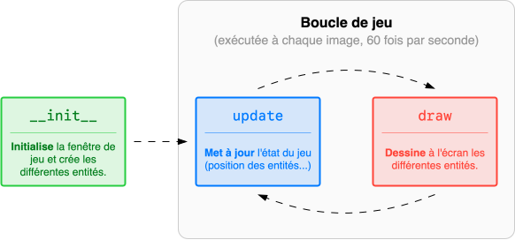
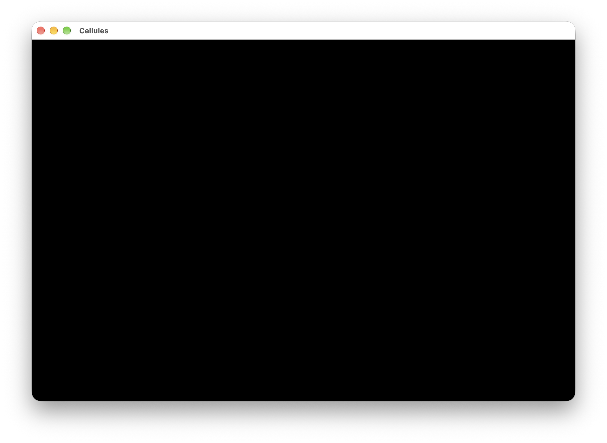
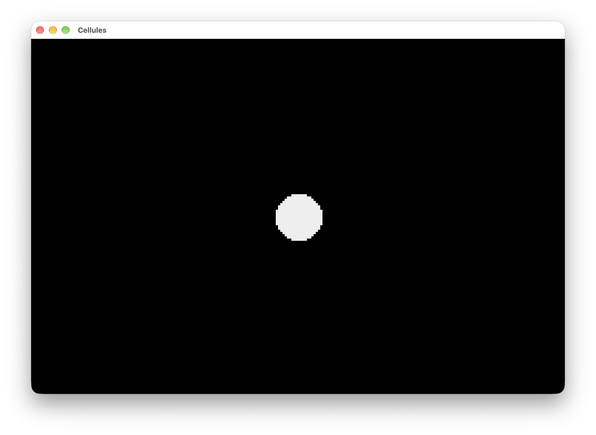
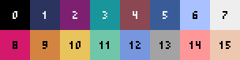
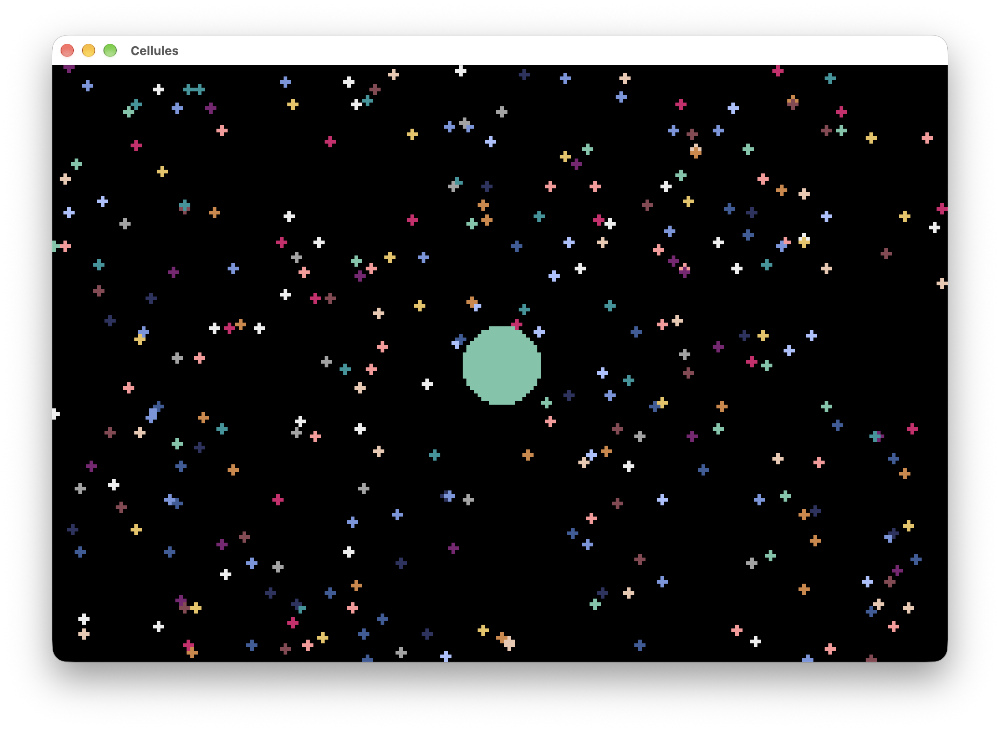
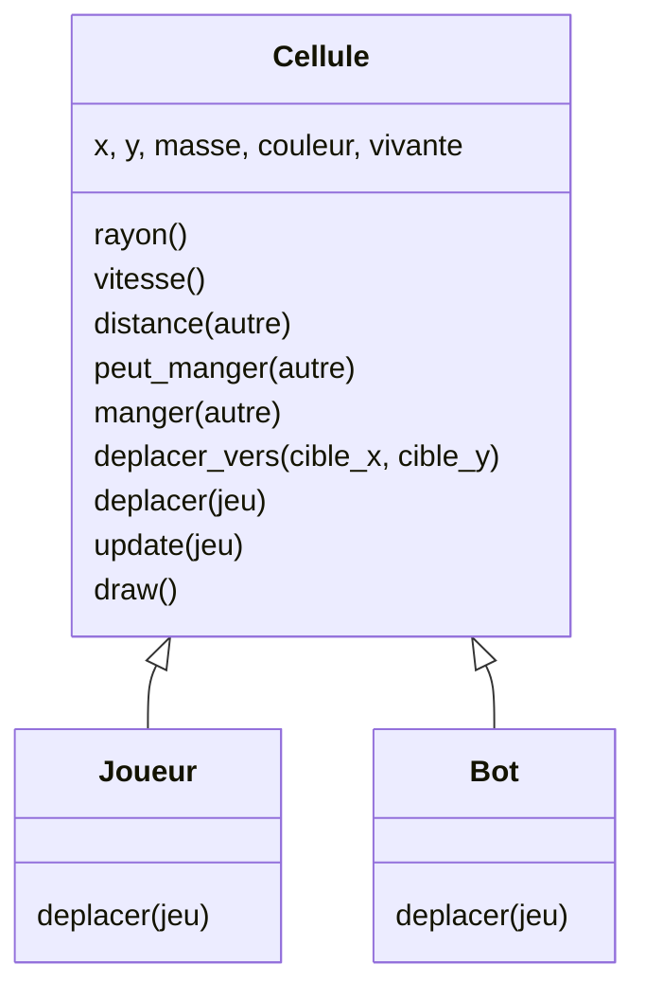

# Cellules, un Agar.io simplifié

## Description

Dans le jeu [Agar.io](https://fr.wikipedia.org/wiki/Agar.io), chaque joueur dirige une cellule dans une boîte de Petri. Le principe du jeu est simple&nbsp;: **on mange ce qui est plus petit que soi, on se fait manger par ce qui est plus gros.** Chaque repas fait grossir, mais plus on est gros, plus on est lent.

{ .rounded-img .pixel-img }
/// caption
La version finale&nbsp;: le joueur (en vert), les bots (en rouge) et la nourriture.
///


Le but de ce mini-projet est d'en programmer une version simplifiée avec le module **Pyxel** en **programmation orientée objet**.

Grains, joueur et bots sont **tous des cellules**&nbsp;: une seule classe `#!py Cellule` suffit pour créer des centaines d'objets. Le joueur et les bots ne diffèrent que par leur déplacement&nbsp;: on utilisera l'**héritage** (hors-programme).


## Rendu attendu

* Un **fichier `.py`** contenant la version la plus avancée de votre jeu. Il doit s'exécuter sans erreur, et chaque méthode doit être commentée.

* Un **compte rendu** qui répond aux questions numérotées et décrit les améliorations ajoutées dans la section « *À votre sauce* ».

!!! info "Documentation Pyxel"
    Toutes les fonctions de Pyxel utilisées dans ce projet (`#!py pyxel.circ`, `#!py pyxel.rndf`, `#!py pyxel.mouse_x`, `#!py pyxel.camera`…) sont décrites dans la [documentation de Pyxel](https://kitao.dev/pyxel/api-reference/).


## Le programme minimal

Pyxel fonctionne avec une **boucle de jeu**&nbsp;: tant que la fenêtre est ouverte, Pyxel appelle la méthode `#!py update` (mettre à jour les données du jeu), puis la méthode `#!py draw` (dessiner l'image), et recommence.

{ .center-img }

On regroupe tout le jeu dans une classe `#!py Jeu`. Les entités du jeu (grains, joueur, adversaires…) seront des **attributs** de cette classe.

=== "Code"

    ```python
    import pyxel

    LARGEUR_ECRAN = 240  # (1)!
    HAUTEUR_ECRAN = 160


    class Jeu:
        def __init__(self):
            pyxel.init(LARGEUR_ECRAN, HAUTEUR_ECRAN, title="Cellules", fps=60)  # (2)!
            pyxel.run(self.update, self.draw)  # (3)!

        def update(self):
            pass  # (4)!

        def draw(self):
            pyxel.cls(0)  # (5)!


    Jeu()  # (6)!
    ```

    1. Les dimensions de l'écran sont des **constantes**, écrites en majuscules. Elles resserviront pour placer les objets dans la fenêtre.

    2. On crée une **fenêtre** de 240 × 160 pixels, intitulée « Cellules », qui s'actualise **60 fois par seconde**.

    3. On démarre la boucle de jeu. Les méthodes `#!py self.update` et `#!py self.draw` sont écrites **sans parenthèses**&nbsp;: on ne les appelle pas, on les **donne** à Pyxel, qui les appellera à chaque image.

    4. Pour l'instant, il n'y a rien à mettre à jour.

    5. On efface l'écran en le remplissant avec la couleur 0 (noir).

    6. On crée **un seul** objet `#!py Jeu`&nbsp;: cela exécute `#!py __init__`, donc ouvre la fenêtre et lance la boucle de jeu.

=== "Rendu"

    { .center-img .pixel-img }

Ce code constitue **le point de départ** de n'importe quel jeu Pyxel&nbsp;.

<div class="sl-steps" start="1" markdown>

1. Ajouter `#!py print("bonjour")` juste après `#!py pyxel.run(self.update, self.draw)`. Que se passe-t-il&nbsp;? Qu'en déduire sur l'endroit où il faut créer les attributs de `#!py Jeu`&nbsp;?
</div>

## Une classe, des centaines d'objets

On écrit maintenant la classe `#!py Cellule`, puis on modifie `#!py Jeu` pour créer et afficher une cellule. Les lignes ajoutées par rapport au programme minimal sont surlignées&nbsp;:

=== "Code"

    ```python hl_lines="1 8-18 24 32"
    import math  # (1)!
    import pyxel

    LARGEUR_ECRAN = 240
    HAUTEUR_ECRAN = 160


    class Cellule:  # (2)!
        def __init__(self, x, y, masse):
            self.x = x  # (3)!
            self.y = y
            self.masse = masse

        def rayon(self):
            return math.sqrt(self.masse)  # (4)!

        def draw(self):
            pyxel.circ(self.x, self.y, self.rayon(), 7)  # (5)!


    class Jeu:
        def __init__(self):
            pyxel.init(LARGEUR_ECRAN, HAUTEUR_ECRAN, title="Cellules", fps=60)
            self.cellule = Cellule(120, 80, 100)  # (6)!
            pyxel.run(self.update, self.draw)

        def update(self):
            pass

        def draw(self):
            pyxel.cls(0)
            self.cellule.draw()  # (7)!


    Jeu()
    ```

    1. Le module `#!py math` fournit la racine carrée `#!py math.sqrt`.

    2. La classe est un **moule**&nbsp;: elle décrit ce qu'est une cellule, mais n'en crée aucune.

    3. Chaque objet `#!py Cellule` aura **ses propres** attributs `#!py x`, `#!py y` et `#!py masse`.

    4. Le rayon se calcule à partir de la masse (voir l'encadré ci-dessous).

    5. Un disque de centre `(x, y)`, de rayon `#!py self.rayon()` et de couleur 7 (blanc).

    6. On crée **un objet** `#!py Cellule` au centre de l'écran, de masse 100, donc de rayon 10. Il est créé **avant** `#!py pyxel.run` (voir question 1).

    7. `#!py Jeu.draw` ne sait pas *comment* se dessine une cellule&nbsp;: elle le lui **demande**. Chaque objet est responsable de son propre affichage.

=== "Rendu"

    { .center-img .pixel-img }

!!! info "Pourquoi la racine carrée de la masse&nbsp;?"
    La **surface** du disque $\pi r^2$ doit être proportionnelle à la masse $m$, d'où $r = \sqrt{m}$.

<div class="sl-steps" start="2" markdown>

2. **Ajouter une couleur.** Ajouter à `#!py Cellule` un attribut `#!py couleur`, passé en paramètre au constructeur (`#!py Cellule(x, y, masse, couleur)`), et l'utiliser dans `#!py draw`. Notre cellule sera de la couleur de votre choix. Pyxel dispose des couleurs suivantes, numérotées de 0 à 15 :

    { .center-img .rounded-img .pixel-img style="margin: 1.5rem auto" }

3. **Ajouter la nourriture.** Ajouter une constante `#!py NB_GRAINS = 300` et, dans le constructeur de `#!py Jeu`, un attribut `#!py self.grains`&nbsp;: une liste de `#!py NB_GRAINS` cellules de masse `#!py 1`, placées au hasard dans l'écran et de couleur au hasard. Les afficher toutes dans `#!py Jeu.draw`, **avant** la grosse cellule.

    ```python
    self.grains = []
    for i in range(NB_GRAINS):
        ...
    ```

    Pour le hasard, utiliser les fonctions `#!py pyxel.rndi(a, b)` (entier aléatoire) et `#!py pyxel.rndf(a, b)` (nombre décimal aléatoire) décrites dans la [documentation de Pyxel](https://kitao.dev/pyxel/api-reference/).
</div>

{ .center-img .pixel-img }


## Le joueur mange les grains

{ .rounded-img .pixel-img }
/// caption
Le joueur suit la souris, mange les grains et grossit.
///

<div class="sl-steps" start="4" markdown>

4. **Créer le joueur.** Dans le constructeur de `#!py Jeu`, afficher le curseur avec `#!py pyxel.mouse(True)` et créer le joueur, une simple `#!py Cellule` placée au centre (avec une constante `#!py MASSE_DEPART = 10`)&nbsp;:

    ```python
    self.joueur = Cellule(LARGEUR_ECRAN / 2, HAUTEUR_ECRAN / 2, MASSE_DEPART, 11)
    ```

    L'afficher dans `#!py Jeu.draw`, **après** les grains.

5. **Suivre la souris.** Ajouter à `#!py Cellule`&nbsp;:

    * `#!py vitesse(self)` qui renvoie la vitesse de la cellule, en pixels par image. Elle renvoie toujours `#!py 1`&nbsp;;
    * `#!py deplacer_vers(self, cible_x, cible_y)` qui avance la cellule de `#!py self.vitesse()` pixels **en direction** du point `(cible_x, cible_y)`.

    Dans `#!py Jeu.update`, appeler `#!py self.joueur.deplacer_vers(pyxel.mouse_x, pyxel.mouse_y)`.

    ??? info "Comment avancer vers la cible&nbsp;?"
        /// html | div.schema-vecteur
        ///

        On raisonne avec des **vecteurs**&nbsp;:

        1. **Le vecteur vers la cible** a pour coordonnées `#!py dx = cible_x - self.x` et `#!py dy = cible_y - self.y`.
        2. **Sa longueur** se calcule avec le théorème de Pythagore&nbsp;: $d = \sqrt{dx^2 + dy^2}$.
        3. **On le normalise**&nbsp;: en divisant `#!py dx` et `#!py dy` par $d$, on obtient un vecteur de **même direction** mais de **longueur 1** (en bleu).
        4. **On le multiplie par la vitesse** $v$ (en orange) et on l'ajoute à la position&nbsp;: la cellule avance d'exactement `#!py self.vitesse()` pixels vers la cible.
        5. Si $d$ est plus petit que la vitesse, la cellule dépasserait la cible et tremblerait autour du curseur (et si $d = 0$, la division est impossible). Dans ce cas, placer directement la cellule sur la cible.

6. **Manger.** Ajouter à `#!py Cellule` un attribut `#!py vivante`, initialisé à `#!py True` dans le constructeur, puis les méthodes suivantes&nbsp;:

    * `#!py peut_manger(self, autre)` qui renvoie `#!py True` si les **deux** cellules sont vivantes, si `#!py self` est plus plus massive que `#!py autre` et si **le centre** de `#!py autre` est dans le disque de `#!py self`&nbsp;;
    * `#!py manger(self, autre)` qui ajoute la masse de `#!py autre` à celle de `#!py self` et passe `#!py autre.vivante` à `#!py False`.

    Dans `#!py Jeu.update`, faire manger au joueur les grains qu'il peut manger.

    !!! info "Indication&nbsp;: éviter la racine carrée"
        Le jeu teste des centaines de grains à chaque image, et la racine carrée est un calcul coûteux. Or $d < r \iff d^2 < r^2$, et $r^2 = m$&nbsp;: le test sur la distance devient simplement `#!py dx * dx + dy * dy < self.masse`.

7. **Faire réapparaître les grains.** Les grains mangés doivent disparaître de la liste (lire l'encadré ci-dessous) et être remplacés pour qu'il y en ait toujours `#!py NB_GRAINS`. Créer dans `#!py Jeu` une méthode `#!py nouveau_grain(self)` qui **renvoie** un grain placé au hasard, et l'utiliser dans le constructeur et pour les remplacements.

    ??? danger "Point de vigilance&nbsp;: ne jamais supprimer pendant qu'on parcourt"
        Ce code est faux&nbsp;:

        ```python
        for grain in self.grains:
            if self.joueur.peut_manger(grain):
                self.joueur.manger(grain)
                self.grains.remove(grain)  # NON !
        ```

        `#!py remove` décale les éléments suivants d'une case vers la gauche, alors que la boucle `#!py for` avance d'une case&nbsp;: l'élément qui suit celui qu'on supprime est **sauté**. Essayez&nbsp;:

        ```pycon
        >>> nombres = [1, 2, 2, 3]
        >>> for n in nombres:
        ...     if n == 2:
        ...         nombres.remove(n)
        >>> nombres
        [1, 2, 3]
        ```

        La bonne méthode se fait en deux temps&nbsp;: **pendant** la boucle, on **marque** les cellules mangées (c'est le rôle de l'attribut `#!py vivante`)&nbsp;; **après** la boucle, on ne garde que les vivantes&nbsp;:

        ```python
        def garder_vivantes(cellules):
            resultat = []
            for cellule in cellules:
                if cellule.vivante:
                    resultat.append(cellule)
            return resultat
        ```

        Cette fonction (placée en dehors des classes) s'utilise après la boucle des repas&nbsp;: `#!py self.grains = garder_vivantes(self.grains)`.
</div>

[À continuer]

<!-- 

## Des adversaires grâce à l'héritage

{ .rounded-img .pixel-img }
/// caption
Les bots chassent ce qu'ils peuvent manger… y compris le joueur.
///

On ajoute une dizaine d'adversaires, les **bots**, qui se dirigent vers la cellule mangeable la plus proche. Le joueur et les bots sont des cellules comme les autres&nbsp;; ils ne diffèrent que par **leur façon de choisir où aller**. Les classes `#!py Joueur` et `#!py Bot` vont donc **hériter** de `#!py Cellule` et **redéfinir** une seule méthode, `#!py deplacer`.



On ajoute deux méthodes à `#!py Cellule`. Par défaut, une cellule ne bouge pas (c'est le cas des grains)&nbsp;:

```python
class Cellule:
    ...

    def deplacer(self, jeu):
        pass

    def update(self, jeu):
        self.deplacer(jeu)
```

Puis on crée la classe `#!py Joueur`, qui redéfinit `#!py deplacer`&nbsp;:

```python
class Joueur(Cellule):
    def deplacer(self, jeu):
        self.deplacer_vers(pyxel.mouse_x, pyxel.mouse_y)
```

Le paramètre `#!py jeu` donne accès à tout le jeu (grains, bots, joueur). Dans `#!py Jeu.update`, on écrira `#!py self.joueur.update(self)`&nbsp;: ici, `#!py self` désigne le jeu.

<div class="sl-steps" start="8" markdown>

8. La classe `#!py Joueur` n'a pas de constructeur `#!py __init__`. Comment Python fait-il pour créer `#!py Joueur(120, 80, MASSE_DEPART, 11)`&nbsp;?

9. **Organiser le jeu.** Ajouter d'abord à `#!py Cellule` une méthode `#!py distance(self, autre)` qui renvoie la distance entre les centres de deux cellules (même calcul que dans `#!py deplacer_vers`). Puis, dans `#!py Jeu`&nbsp;:

    * déplacer la création des objets dans une méthode `#!py reset(self)`, appelée par le constructeur juste **avant** `#!py pyxel.run`&nbsp;; le joueur devient un `#!py Joueur`&nbsp;;
    * ajouter une constante `#!py NB_BOTS = 10`, une liste `#!py self.bots` et une méthode `#!py nouveau_bot(self)` qui renvoie un `#!py Bot` placé au hasard, de masse `#!py pyxel.rndi(4, 30)` et de couleur `#!py 8`. Pour éviter une défaite immédiate, retirer sa position avec une boucle `#!py while` tant que `#!py bot.distance(self.joueur) < 60`&nbsp;;
    * ajouter une méthode `#!py cellules(self)` qui renvoie `#!py self.grains + self.bots + [self.joueur]`.

10. **Le bot chasseur.** Écrire la classe `#!py Bot(Cellule)`, dont la méthode `#!py deplacer(self, jeu)` cherche parmi `#!py jeu.cellules()` la cellule **vivante** la plus proche qu'il est assez massif pour manger, et s'en approche avec `#!py deplacer_vers`.

    !!! info "Indications"
        * Isolez la condition sur les masses dans une méthode `#!py assez_grosse_pour(self, autre)` de `#!py Cellule`, et réutilisez-la dans `#!py peut_manger`.
        * Pour trouver la plus proche, c'est une recherche de minimum&nbsp;: on mémorise la meilleure cellule et sa distance.

            ```python
            cible = None
            distance_min = 0
            for autre in jeu.cellules():
                ...
            ```

11. **Les repas.** Dans `#!py Jeu.update`, appeler `#!py update(self)` sur le joueur et sur chaque bot. Puis, avec `#!py mangeurs = [self.joueur] + self.bots` et deux boucles imbriquées, chaque mangeur essaie de manger les grains **et** les autres mangeurs. Après les boucles, filtrer les grains et les bots avec `#!py garder_vivantes` et compléter les deux listes.

    Pourquoi n'est-il pas nécessaire de vérifier qu'une cellule n'essaie pas de se manger elle-même&nbsp;?

12. **Partie perdue.** Si le joueur a été mangé, `#!py Jeu.update` attend seulement un clic (`#!py pyxel.btnp(pyxel.MOUSE_BUTTON_LEFT)`) pour appeler `#!py self.reset()`, et `#!py Jeu.draw` affiche « Perdu ! » et « Cliquez pour rejouer ».

13. `#!py self.joueur.update(self)` et `#!py bot.update(self)` exécutent le même code de `#!py Cellule.update`. Pourtant, le bot et le joueur ne se déplacent pas de la même façon. Expliquer.

</div>

## Un monde plus grand que l'écran

{ .rounded-img .pixel-img }
/// caption
La caméra suit le joueur dans un monde de 400 × 400 pixels.
///

On utilise maintenant un monde de 400 × 400 pixels, dont la fenêtre de 240 × 160 ne montre qu'une partie, centrée sur le joueur. Il faut distinguer&nbsp;:

* les **coordonnées monde** (entre `0` et `400`)&nbsp;: les attributs `#!py x` et `#!py y` des cellules&nbsp;;
* les **coordonnées écran** (entre `0` et `240` horizontalement, `0` et `160` verticalement)&nbsp;: la position d'un pixel dans la fenêtre.

La **caméra** est la position, en coordonnées monde, du coin supérieur gauche de l'écran. Après `#!py pyxel.camera(camera_x, camera_y)`, Pyxel soustrait automatiquement `camera_x` et `camera_y` à tout ce qui est dessiné&nbsp;:

```python
x_ecran = x_monde - camera_x  # ce que fait pyxel.camera pour l'affichage
x_monde = x_ecran + camera_x  # la conversion inverse
```

<div class="sl-steps" start="14" markdown>

14. **Agrandir le monde.** Ajouter les constantes `#!py LARGEUR_MONDE = 400` et `#!py HAUTEUR_MONDE = 400`, et les utiliser pour toutes les positions dans le monde (départ du joueur, apparition des grains et des bots). Le monde étant environ quatre fois plus grand, passer `#!py NB_GRAINS` à `#!py 1000`.

15. **Placer la caméra.** Ajouter à `#!py Jeu` les attributs `#!py camera_x` et `#!py camera_y`, et une méthode `#!py placer_camera(self)` qui les calcule pour que le joueur soit **au centre** de l'écran. L'appeler dans `#!py reset` et dans `#!py update` juste après les déplacements.

16. **Dessiner.** Dans `#!py Jeu.draw`, appeler `#!py pyxel.camera(self.camera_x, self.camera_y)` avant de dessiner le monde, puis `#!py pyxel.camera()` pour revenir en coordonnées écran avant d'afficher le score (la masse du joueur) en haut à gauche. Que se passe-t-il si on oublie `#!py pyxel.camera()`&nbsp;?

    !!! info "Indication"
        Sur un fond uni, on ne voit pas que l'on bouge&nbsp;! Dessinez un quadrillage, par exemple une ligne de couleur `#!py 1` tous les 20 pixels avec `#!py range(0, LARGEUR_MONDE + 1, 20)`.

17. **Convertir la souris.** Tester le jeu&nbsp;: le joueur file vers le coin supérieur gauche du monde. Pourquoi&nbsp;?

    !!! warning "Indication essentielle"
        `#!py pyxel.mouse_x` et `#!py pyxel.mouse_y` sont des **coordonnées écran**, alors que `#!py deplacer_vers` attend une cible en **coordonnées monde**. Il faut convertir la position de la souris dans `#!py Joueur.deplacer`, avec `#!py jeu.camera_x` et `#!py jeu.camera_y`.

18. **Rester dans le monde.** Compléter `#!py Cellule.update` pour que, après le déplacement, `#!py x` reste entre `0` et `#!py LARGEUR_MONDE` et `#!py y` entre `0` et `#!py HAUTEUR_MONDE` (avec `#!py min` et `#!py max`).

</div>

## À votre sauce

Choisissez une ou plusieurs améliorations (ou inventez-en d'autres) et décrivez-les dans votre compte rendu. Les étoiles indiquent la difficulté.

* ★ **Perte de masse.** Les cellules perdent lentement de la masse, par exemple ×&nbsp;`#!py 0.9995` à chaque image. Combien de pourcents par seconde cela représente-t-il&nbsp;?
* ★★ **Bots prudents.** Un bot fuit les cellules assez grosses pour le manger quand elles sont proches (viser le point `#!py (2 * self.x - autre.x, 2 * self.y - autre.y)`).
* ★★ **Classement.** Afficher les masses des 5 plus grosses cellules, avec un tri écrit à la main.
* ★★ **Virus.** Une classe `#!py Virus(Cellule)` immobile&nbsp;: les petites cellules se cachent dessous, les grosses qui le touchent perdent la moitié de leur masse.
* ★★ **Deux joueurs.** Un second joueur, `#!py JoueurClavier(Cellule)`, se déplace avec `#!py pyxel.btn(pyxel.KEY_Z)`, `#!py pyxel.btn(pyxel.KEY_S)`…
* ★★★ **Division.** La touche espace (`#!py pyxel.btnp(pyxel.KEY_SPACE)`) divise la cellule du joueur en deux, l'une étant projetée vers la souris. Le joueur contrôle alors une liste de cellules.
* ★★★ **Complexité.** Passer à 2000 puis 5000 grains et mesurer le temps de `#!py Jeu.update` avec `#!py time.perf_counter()`. Combien de tests `#!py peut_manger` fait-on par image&nbsp;? Une image dure environ 16,7&nbsp;ms&nbsp;: quand le jeu ralentit-il&nbsp;? Comment ne tester que les grains **proches**&nbsp;? -->
